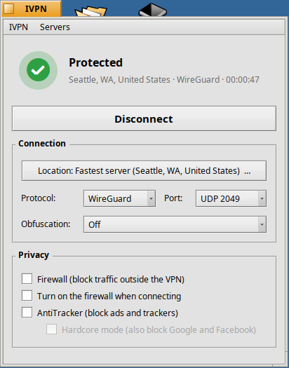
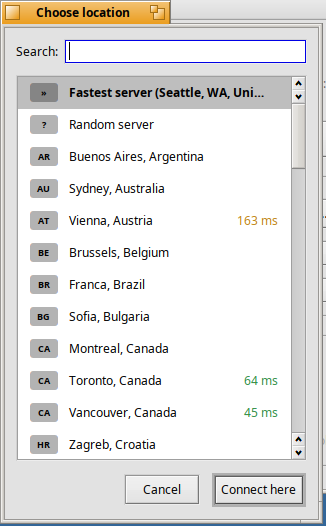
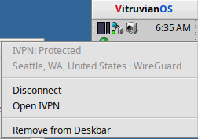

# IVPN for Vitruvian

A native window for IVPN on Vitruvian (VitruvianOS), a BeOS-like OS based on
Linux, written against its Haiku API. It replaces the Electron `ivpn-ui`, which cannot run on Vitruvian. The VPN work is still done by the
official IVPN background service (`ivpn-service`, from the `ivpn` package),
the same one the `ivpn` command uses. So the app, the command and the official
app all stay in sync.

## What it does

- Log in with your account ID, including 2FA and "too many devices"
- Connect or disconnect, with a live status (green / amber / red) and time connected
- Choose a location from a searchable list with latency, or Fastest / Random
- Protocol (WireGuard or OpenVPN) and port
- Obfuscation, for networks that block VPNs: V2Ray (QUIC or TCP) for
  WireGuard; obfs3, obfs4 (with IAT modes) or V2Ray for OpenVPN
- A Deskbar item that shows the connection status (right-click it to
  connect, disconnect or open the app; **IVPN → Show in Deskbar** turns it
  on or off)
- Firewall (kill switch), "firewall on connect", AntiTracker and Hardcore mode
- Desktop notifications when the connection comes up or drops
- Changing location, protocol, port, obfuscation or AntiTracker while connected reconnects
  automatically, like the official app

Closing the window does **not** disconnect the VPN; the service keeps running.

Not included yet: multi-hop, split tunnel, custom DNS, captcha logins (log
in once with `ivpn login` if IVPN asks for one), and Enhanced App
Authentication.

## Screenshots



Connected to the fastest server over WireGuard, on VitruvianOS at 800×600.



Choosing a location: search, Fastest or Random, and each server's latency.



The Deskbar item's right-click menu, with the green "protected" lamp behind it.

## Install (Vitruvian 0.6.2 or newer, x86_64 or ARM64)

Open **Terminal** and run these one block at a time.

**1. Install the IVPN service** (official IVPN repository):

```sh
sudo apt update && sudo apt install -y gpg curl
curl -fsSL https://repo.ivpn.net/stable/debian/generic.gpg | gpg --dearmor > ~/ivpn-archive-keyring.gpg
sudo mv ~/ivpn-archive-keyring.gpg /usr/share/keyrings/ivpn-archive-keyring.gpg
sudo chown root:root /usr/share/keyrings/ivpn-archive-keyring.gpg && sudo chmod 644 /usr/share/keyrings/ivpn-archive-keyring.gpg
curl -fsSL https://repo.ivpn.net/stable/debian/generic.list | sudo tee /etc/apt/sources.list.d/ivpn.list
sudo apt update && sudo apt install -y ivpn
```

Install `ivpn`, **not** `ivpn-ui` (that is the Electron app).

Check the service is running:

```sh
ivpn status
```

**2. Install this app.** Download the `.deb` for your machine from the
[latest release](https://github.com/idumych/ivpn-vitruvian/releases/latest)
(`dpkg --print-architecture` tells you which). Then, in the folder where you
saved it, run:

```sh
sudo apt install ./ivpn-vitruvian_1.0.2_amd64.deb    # Intel/AMD PCs
sudo apt install ./ivpn-vitruvian_1.0.2_arm64.deb    # ARM64 machines
```

**3. Open it** from the Deskbar: **Applications → IVPN**.

To remove it: `sudo apt remove ivpn-vitruvian`

## If something goes wrong

- **"The IVPN service is not reachable":** start it with
  `sudo systemctl enable --now ivpn-service`. The app retries every few seconds.
- **The connection fails right away:** try it from Terminal with
  `ivpn connect -fastest`. If that fails too, the problem is in the service or
  system rather than this app, and `sudo journalctl -u ivpn-service` shows why.
- **Settings** are saved in `~/config/settings/IVPN/settings.json`. Delete
  that file to reset them.

## Build it yourself

On a Vitruvian machine, in this folder:

```sh
./build.sh
```

This uses only what Vitruvian already has (g++, curl, dpkg). The first time,
it downloads the Vitruvian headers that match your installed version. The
result is a fresh `ivpn-vitruvian_<version>_<arch>.deb` for that machine.

To build the ARM64 package on an x86_64 PC instead, unpack the ARM64
Vitruvian image's root filesystem somewhere (it is the "sysroot") and run:

```sh
TARGET_ARCH=arm64 VOS_VERSION=0.6.2 VOS_SRC=/path/to/Vitruvian-source \
CXX="clang++ --target=aarch64-linux-gnu --sysroot=/path/to/arm64-root -fuse-ld=lld" \
STRIP=llvm-strip ./build.sh
```

## How it is built (for developers)

```
src/core/   protocol + data model, plain C++17, no Haiku API
            DaemonConnection  TCP to 127.0.0.1, port/secret from port.txt,
                              newline-delimited JSON, Hello handshake
            Model             server list, pings, settings, Connect params
            Requests.h        every request the app sends
src/ui/     Haiku API window, location picker, status header
tests/      core tests against a fake daemon (any Linux: tests/run_tests.sh)
            gocheck/: decodes every request with the real daemon's Go
            types (unknown fields rejected)
third_party/json.hpp   nlohmann/json 3.11.3 (MIT)
```

License: GPL v3, the same as IVPN's desktop-app. IVPN is a trademark of
Privatus Limited; this is not an official IVPN product.
